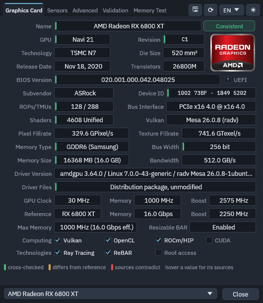
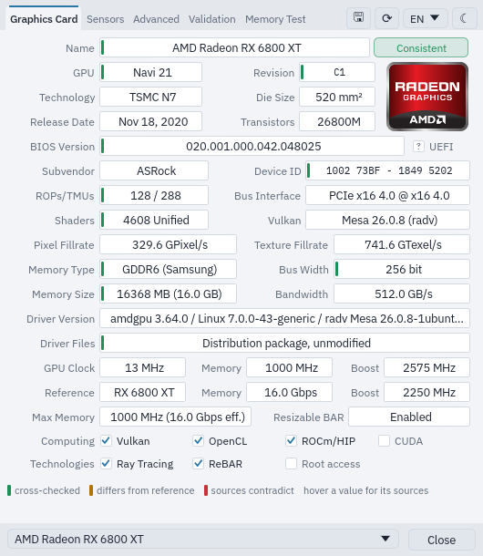
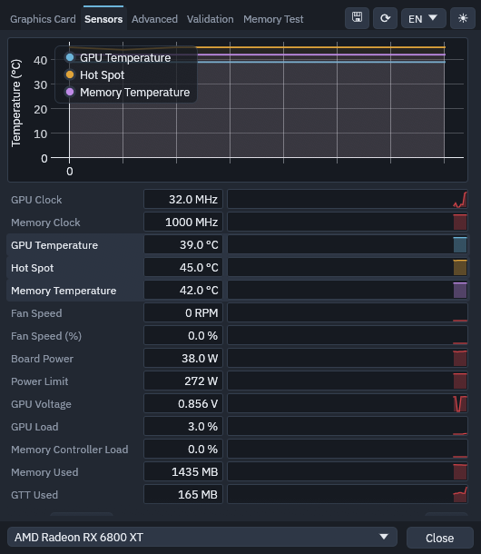
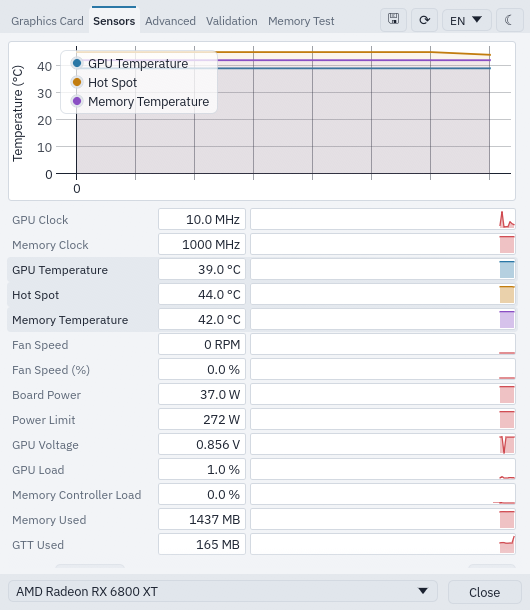
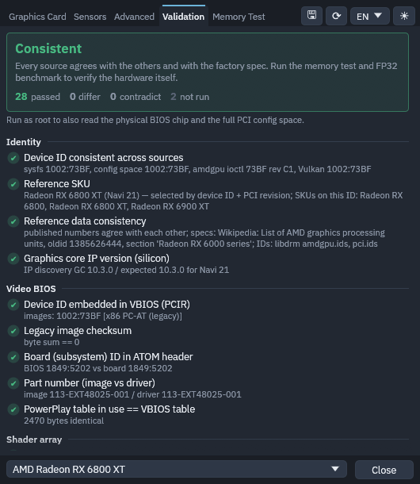
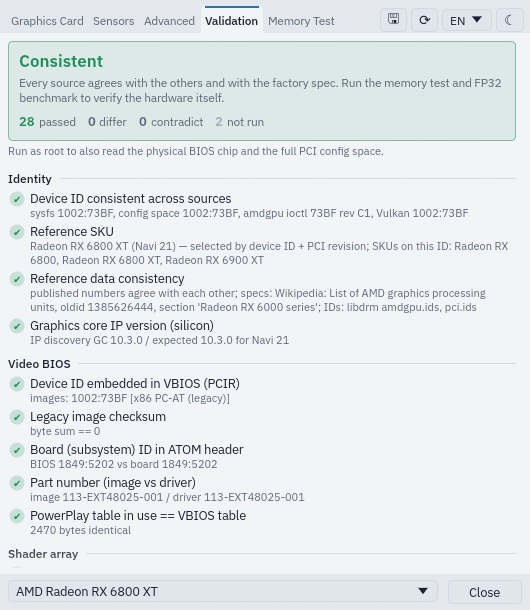
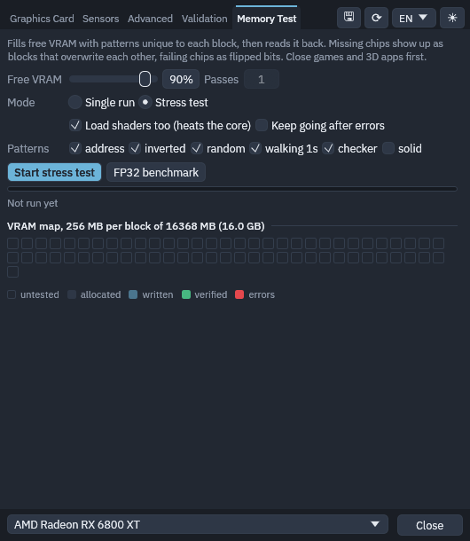
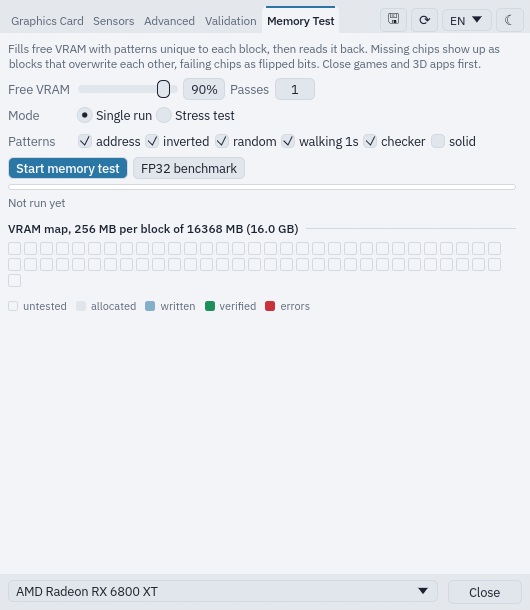
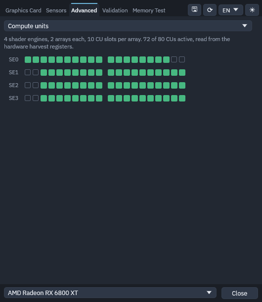
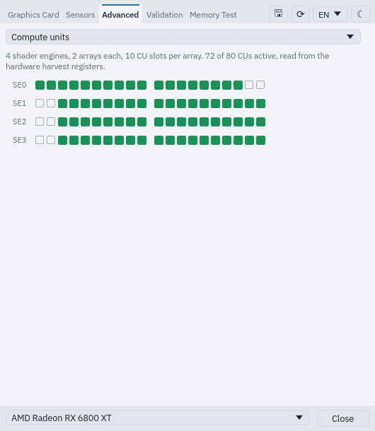

# GPU-R

**A graphics card information and authenticity checker for Linux and Windows, written in Rust.**

GPU-R shows your video card the way GPU-Z does: chip, revision, shaders, memory, BIOS, driver, bus, clocks and live sensors. The difference is that it does not trust any single source. Each value is read from several independent places (PCI config space, the kernel driver, the VBIOS image, Vulkan/DX12, NVML, a physical memory test) and compared. A patched BIOS, unlocked or fused-off units, a memory-size mod, a relabelled chip or a tampered driver therefore shows up as a contradiction, not as a believable number.



## Features

- **GPU-Z style card overview** with a reference database of desktop GPUs from Radeon HD 4000 to RX 9000 / Radeon AI Pro R9700 and from GeForce GTX 400 to RTX 50.
- **Cross-checks on every value.** A coloured edge on each field marks whether it was cross-checked, differs from the factory reference or has contradicting sources. Hover a field to see the sources it came from.
- **Validation tab** with roughly 30 checks, grouped into identity, video BIOS, shader array, memory, driver and PCIe, and an overall verdict.
- **VRAM test** that writes patterns unique to every 256 MB block and reads them back:
  - missing memory chips show up as blocks that overwrite each other;
  - failing chips show up as flipped bits;
  - the driver's usage counter confirms the data really sat in VRAM and not in system RAM.
- **Stress test.** It loops the VRAM test until you stop it, an error appears or the GPU hangs. It can also load the shaders at the same time to heat the core. Every pass is appended to a log file and flushed to disk, so you can see how long the card lasted even after a hard freeze.
- **FP32 benchmark** that measures real shader throughput and derives the number of working lanes, so a card with fewer working shaders than it reports is detected.
- **Sensors** with history graphs: temperatures (edge, hotspot, memory), clocks, power, voltage, fan, load and memory use, plus logging to a CSV file.
- **Advanced tab:**
  - compute-unit map read from the hardware harvest registers (AMD);
  - firmware versions, VBIOS images and checksums;
  - driver file integrity, PCI BARs and Resizable BAR;
  - the reference record together with its sources.
- **Dark and light themes.**
- **Five languages:** English, Ukrainian, Russian, Polish and German. The language is detected from the system and can be changed in the window.
- **Single-file binaries.** The Windows build is one `.exe` with a static C runtime; fonts, logos and the database are embedded.

## Screenshots

| | Dark | Light |
|---|---|---|
| Graphics Card |  |  |
| Sensors |  |  |
| Validation |  |  |
| Memory Test |  |  |
| Advanced |  |  |

## Download

Prebuilt binaries are in [`dist/`](dist/):

| Platform | File | Requirements |
|---|---|---|
| Linux x86-64 | `dist/linux-x86_64/gpu-r` | glibc; a Vulkan driver for the memory test and the benchmark |
| Windows 10/11 x86-64 | `dist/windows-x86_64/gpu-r.exe` | nothing extra |

SHA-256 checksums are in `dist/SHA256SUMS`.

## What gets checked

| Trick | How GPU-R catches it |
|---|---|
| Cross-flashed or relabelled card (a cheaper chip sold as a faster one) | The device ID and revision in PCI config space, sysfs, the driver ioctl, Vulkan and the VBIOS PCIR header must all agree. The graphics-core IP version reported by the silicon is compared with the chip's known version. |
| Modified BIOS | The PCIR IDs and the board ID in the ATOM header are compared with the real hardware. The legacy image checksum is verified. On AMD, the PowerPlay table the driver actually uses is compared with the one in the VBIOS. The driver's copy of the BIOS is compared with the physical ROM (root only). |
| Unlocked or disabled units | The compute-unit count comes from the hardware harvest registers. It is compared with the driver's count, the reference SKU and the measured FP32 throughput. |
| Memory-size mod or fake VRAM | VRAM size is read through several driver interfaces and checked against the factory sizes and the PCI BAR aperture. The size must also be possible for the bus width. The memory test then proves that the capacity physically exists. |
| Patched or injected driver | Package-manager checksums of the driver files are verified. The loaded module is compared with the module on disk. Module signature, kernel and module taint flags, and `LD_PRELOAD` / `ld.so.preload` are checked. |

## Usage

```
gpu-r                 start the GUI
gpu-r --report        full report (info + validation) on stdout
gpu-r --json          JSON report
gpu-r --memtest [F]   VRAM test over fraction F of free VRAM (default 0.9)
gpu-r --stress [F]    VRAM + core stress test, loops until Ctrl+C, an error or a GPU hang
gpu-r --compute       FP32 throughput test (verifies the shader count)
gpu-r --sensors [N]   print N sensor samples
gpu-r --gpu I         select the GPU by index
gpu-r --dump-rom FILE save the VBIOS image
```

**Linux:**
- AMD (`amdgpu`) gives the most complete data: harvest registers, VBIOS, PowerPlay and firmware.
- NVIDIA support uses NVML from the proprietary driver.
- Run as root to also read the physical BIOS chip and the full PCI config space.

**Windows:**
- The card is identified from the PnP instance ID (vendor, device, subsystem and revision), and the VRAM size comes from the display driver's registry key.
- NVIDIA cards are additionally read through NVML.
- The memory test and the benchmark run on Vulkan, or on DX12 if Vulkan is missing.
- The BIOS chip and the driver files cannot be read on Windows, so those checks are skipped.

## Reference database

`assets/gpudb.json` is embedded in the binary. It is generated by [`tools/build_gpudb.py`](tools/build_gpudb.py) from these sources:

| Data | Source |
|---|---|
| PCI device ID + revision → AMD product | libdrm [`data/amdgpu.ids`](https://gitlab.freedesktop.org/mesa/drm/-/blob/main/data/amdgpu.ids) (maintained by AMD); [`pci.ids`](https://pci-ids.ucw.cz/) for pre-GCN chips |
| PCI device ID → NVIDIA product | "Supported NVIDIA GPU Products" appendix of the NVIDIA Linux driver README (390.xx, 470.xx, 580.xx) |
| Factory specifications | Wikipedia, *List of AMD graphics processing units* and *List of Nvidia graphics processing units*, pinned to a page revision |

Every record carries its sources, and the published numbers are cross-checked against each other:
- ROPs × clock against the pixel fillrate;
- TMUs × clock against the texture fillrate;
- the memory data rate against its memory type.

Records that fail are marked in the app as an unverified reference, and differences from them are reported with less weight. SKUs that share a device ID are told apart by the PCI revision and then by the active unit count. If nothing tells them apart, GPU-R lists all candidates instead of guessing.

To rebuild the database:

```
python3 -m venv venv && venv/bin/pip install pandas lxml
venv/bin/python tools/build_gpudb.py gpudb-cache assets/gpudb.json
```

## Building

```
cargo build --release      # Linux binary in target/release/gpu-r
./build-dist.sh            # Linux + Windows binaries into dist/
```

Requirements:
- Rust 1.85 or newer (edition 2024).
- The Windows cross-build needs [`cargo-xwin`](https://github.com/rust-cross/cargo-xwin) and `rustup target add x86_64-pc-windows-msvc`.
- `.cargo/config.toml` links the C runtime statically, so the `.exe` needs no Visual C++ redistributable.

## Project layout

```
src/
  main.rs       CLI entry point
  gui.rs        egui front-end (tabs, themes, widgets)
  i18n.rs       translations
  gpu.rs        data collection, displayed fields and validation checks
  db.rs         reference database loader and SKU matching
  pci.rs        PCI config space, BARs, Resizable BAR (Linux)
  win.rs        Windows device enumeration
  amd.rs        amdgpu ioctls, harvest registers, sensors
  nvidia.rs     NVML (loaded at runtime)
  vbios.rs      VBIOS parser (PCIR, ATOM, PowerPlay, NVIDIA BIT)
  integrity.rs  driver file / module integrity
  gputest.rs    VRAM test, stress test and FP32 benchmark (wgpu compute)
  sensors.rs    sampling, history and CSV logging
tools/build_gpudb.py   reference database generator
assets/                fonts, vendor logos, gpudb.json
dist/                  prebuilt binaries
```

## License

GPL-3.0, see [LICENSE](LICENSE). The IBM Plex fonts are under the SIL Open Font License 1.1 (see `assets/fonts/README.md`). AMD, Radeon, NVIDIA, GeForce and Intel logos and names are trademarks of their owners. GPU-R is not affiliated with TechPowerUp or GPU-Z.
